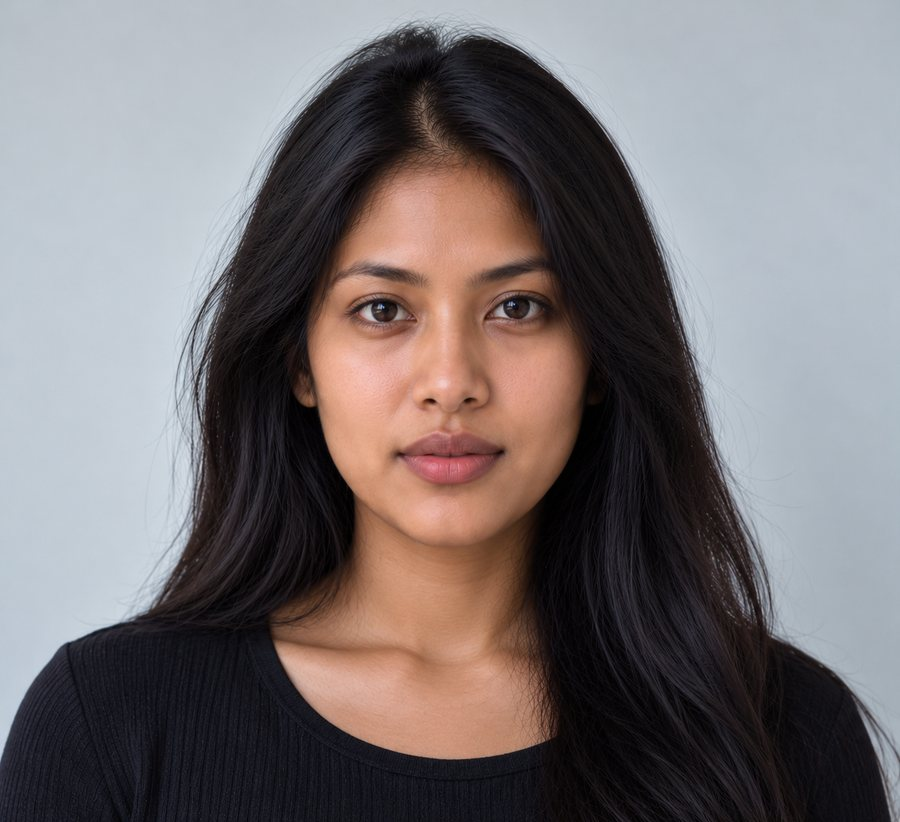
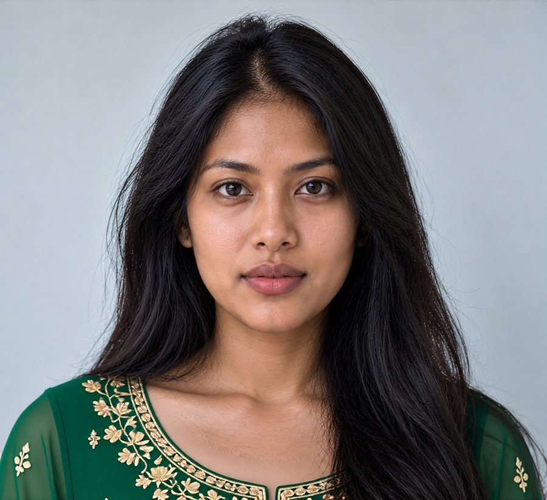
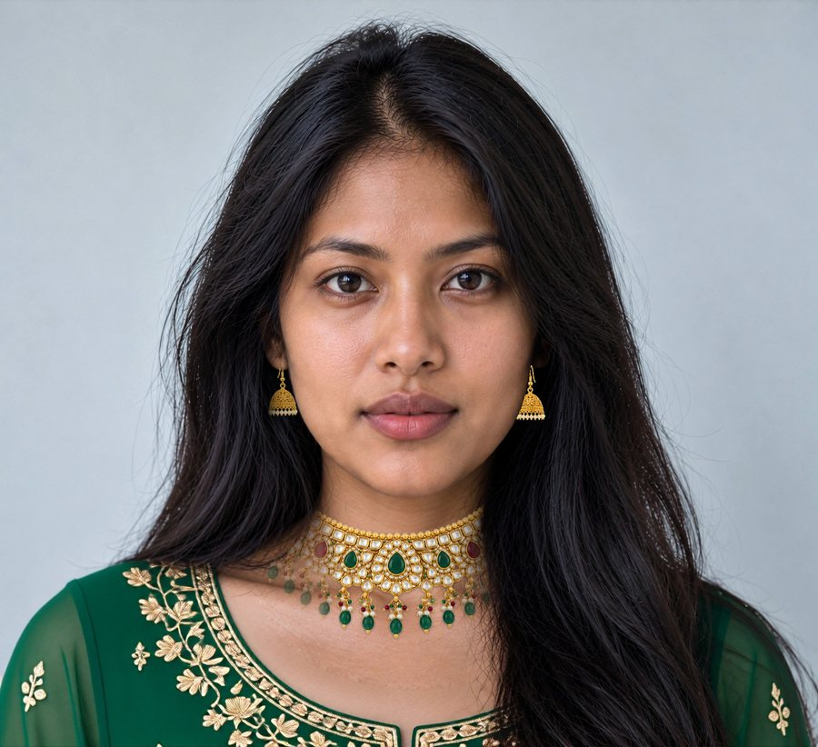

# Complete Look

> Other try-ons show you a dress. Complete Look shows you the whole outfit, in colours chosen for your skin tone, on you.

**One photo. Your colours. The whole outfit.** Built on YouCam APIs for Indian ethnic wear: YouCam measures your colours, a stylist agent picks outfits that stand out against them, and the outfit, jewellery and a lip shade matched to the outfit are tried on your photo, one layer on top of the other.

**Live demo:** [complete-look.vercel.app](https://complete-look.vercel.app) · **Sample shopper:** [complete-look.vercel.app/look/ananya](https://complete-look.vercel.app/look/ananya) · **Video:** `VIDEO_URL` · [How it's built](#how-its-built)

| Before | Outfit | + Jewellery | + Lip colour |
|---|---|---|---|
|  |  |  |  |

*Every image above is a real YouCam result. The sample person and products are AI-generated (ChatGPT), and labelled as such in the app.*

## Try it in a minute

1. Open sample shopper **Ananya** (medium skin depth, wedding guest): [complete-look.vercel.app/look/ananya](https://complete-look.vercel.app/look/ananya). It replays a real recorded run, so there's no sign-up, no keys and no units spent.
2. Open **Kavya** (deep skin depth, office ethnic): [complete-look.vercel.app/look/kavya](https://complete-look.vercel.app/look/kavya). The same catalog ranks differently: the beige set that comes last for Ananya comes second for Kavya.
3. Open **Meera** (light skin depth, Diwali): [complete-look.vercel.app/look/meera](https://complete-look.vercel.app/look/meera).
4. On any look, scroll to **X-ray** to see each YouCam call: the feature, exactly what we sent, the task id, time and units.
5. Try it with your own photo: [complete-look.vercel.app/try](https://complete-look.vercel.app/try). This is live and capped (see [Cost engineering](#cost-engineering)).

## The problem

Ananya has a cousin's wedding next week. She's scrolling lehengas and anarkalis on her phone. The emerald looks great on the model, but will it on her? And which earrings, which necklace, which lip colour go with it? An Indian ethnic outfit is never bought alone. So she orders three, tries them at home and sends two back, or she doesn't buy at all.

Most try-ons answer one question: "how does this one garment look on me?" They don't answer "which colour should I pick?", and they stop at the garment.

## What it does

| Step | What happens | YouCam feature |
|---|---|---|
| 1. Photo | One front-facing photo, from the camera on a phone | File API |
| 2. Colours | Skin and lip colour are measured; outfits are ranked by how clearly they stand out against the skin (depth and contrast) | **AI Facial Color Tones Analyzer** |
| 3. Stylist | A Claude agent picks 2 of the top 3 and explains why, using only the ranking's reasons | (Claude, tool use) |
| 4. Outfit | Both picks are tried on the photo | **AI Clothes Virtual Try-On** |
| 5. Jewellery | Earrings, then a necklace, on top of the outfit result; metal follows the outfit (gold with warm hues, silver with blues) | **AI Earrings Virtual Try-On**, **AI Necklace Virtual Try-On** |
| 6. Makeup | A lip shade derived from the shopper's own measured lip colour, shifted toward the outfit | **AI Makeup Virtual Try-On** |
| 7. Look card | Every piece on one mock product page with ₹ prices | |

## How it's built


Next.js 16 (App Router) on Vercel. The browser never talks to YouCam: it calls our routes, which upload, create the task and poll YouCam server-side with backoff. The YouCam key stays on the server.

### Feature map

| # | YouCam capability | Exactly what we send | Code |
|---|---|---|---|
| 1 | AI Facial Color Tones Analyzer (`skin-tone-analysis`, 20 units) | `{src_file_id}`. We use `skin_color` and `lip_color` and ignore the rest (see Lessons) | [`app/api/analyze-tone/route.ts`](app/api/analyze-tone/route.ts) |
| 2 | AI Clothes Virtual Try-On (`cloth-v4`, 2 units) | `{src_file_id, ref_file_id, garment_category: "full_body"}` | [`lib/youcam/client.ts`](lib/youcam/client.ts) |
| 3 | AI Earrings Virtual Try-On (`2d-vto/earring`, 2 units for a pair) | `{source_info, object_infos: [right ear, left ear], src_file_id, ref_file_ids}` on the outfit result | [`lib/youcam/client.ts`](lib/youcam/client.ts) |
| 4 | AI Necklace Virtual Try-On (`2d-vto/necklace`, 1 unit) | same shape, on the earrings result | [`lib/youcam/client.ts`](lib/youcam/client.ts) |
| 5 | AI Makeup Virtual Try-On (`makeup-vto`, 1 unit) | `{src_file_id, effects: [{category: "lip_color", palettes: [{color: <colorMatch hex>, …}]}]}` on the necklace result | [`lib/youcam/client.ts`](lib/youcam/client.ts) |
| – | AI Scarf Virtual Try-On | Tested, **not used**: it restyles the whole image (see Lessons) | [`SPIKES.md`](SPIKES.md) |

## The one interesting technical idea

**Chaining fashion, jewellery and beauty tasks, with the choice grounded in a measurement.** Each YouCam result is the next task's input: clothes → earrings → necklace → makeup. The choice of what to try comes from colours YouCam actually measured, not from a guess.

A real example from the X-ray for Ananya:

> YouCam colour tone analysis measured a medium skin tone, `#b78565`. We picked emerald green and royal blue because they stand out clearly against it, and skipped beige because it would blend in.

`colorMatch` ([`lib/colorMatch.ts`](lib/colorMatch.ts)) is deterministic. It converts to CIELAB, gets skin depth from the ITA angle, and scores each garment's dominant colours: a wash-out penalty when CIEDE2000 to the skin is under 15, lightness contrast set by depth, and chroma. Garment colours are extracted from the product photos by k-means ([`scripts/prepare-catalog.mjs`](scripts/prepare-catalog.mjs)), never typed by hand. The stylist agent ([`lib/stylist.ts`](lib/stylist.ts)) calls `get_tone_profile`, `search_catalog` and `finalize_look`. The code enforces its limits: picks must come from the top 3, at most 2 are tried on, and a guardrail rejects warm/cool or appearance language and makes Claude try again. That happened in the recorded Ananya run, where `finalize_look` was called twice.

We never tell a shopper she is "warm" or "cool": the analyzer doesn't measure undertone (see Lessons), so that claim would be ours, not YouCam's.

## Evidence

- **v0 → v1 (same shopper, real try-ons):** picked by category only, Ananya gets the beige chikankari set, which sits ΔE 18 from her skin and blends in. Tone-matched, she gets the emerald anarkali (ΔE 47). Both are shown on her sample page. [`docs/evidence.md`](docs/evidence.md)
- **Same catalog, different shoppers:** beige is last for Ananya (medium) and Meera (light) but second for Kavya (deep), where it's clearly lighter than her skin.
- **Failure → recovery:** a jewellery layer that fails is skipped and the look keeps building on the last good image, so the outfit is never lost. The stylist's guardrail rejected a first `finalize_look` and Claude corrected it.
- **Measured (Nov 1, 2026):** tone analysis 10–11 s; clothes 14–23 s; earrings 7–12 s; necklace 5–13 s; lip 9–15 s. One complete look on a new photo is **28 units and 48.6 s of YouCam time** (measured on the live site). A replayed sample costs **0 units**.

## Cost engineering

- One complete look = tone 20 + two outfits 4 + earrings 2 + necklace 1 + lip 1 = **28 units**. Tone is most of it, so tone results are cached by image hash; another outfit on the same photo costs 2.
- Samples replay stored results: **zero YouCam calls on page load**, unlimited views through judging.
- Live mode: every identical request is a cache lookup. Caps are 30 units per visitor per day (one complete look) and a global daily cap (`YOUCAM_DAILY_UNIT_CAP`, 80 by default). When a cap is hit, a "demo limit reached" message points to the samples. `LIVE_MODE=off` pauses live calls. The caps are in memory per server instance (best effort); the YouCam balance is the hard limit.
- Units spent building this: 100 on tone spikes, 16 on try-on spikes, 61 on recording samples, debugging and one live end-to-end test.

## Lessons we paid for

- **The tone analyzer measures depth, not undertone.** Across 5 faces, the skin hue it returned spanned only 58.5–62.6°, while ITA spanned −35° to 34°. A face prompted "cool, pink undertones" came back as golden as the rest. So colour advice is built on depth and contrast.
- `hair_color` came back `#FAF0BE` "Blonde" on 5 of 5 dark-haired faces (a fallback value), and `eyebrow_color` snaps to a few fixed values. We ignore both.
- **Scarf try-on is generative, not a layer.** On our lehenga result it replaced the outfit with a white dress, added a hat and a lakeside background, and turned the dupatta into a neckerchief. We dropped the dupatta step.
- **Makeup try-on also retouches skin:** applying lip colour alone came back with visible smoothing and brightening.
- **A headshot is enough for clothes try-on.** All 5 garments, sarees included, dressed the visible neckline without touching the face. That means results show the top of the outfit, not its full length.
- The makeup request needs `src_file_id` like the others; leaving it out returns `400 InvalidParameters`.

## Limitations and roadmap

- The catalog is 5 outfits and 3 accessories (all AI-generated product shots), not a real store. The product page is a mock; there's no checkout.
- Results show head and shoulders, because we use the same photo for tone analysis and try-on. Next: an optional full-length photo for try-on.
- No dupatta (see Lessons). Next: retry when YouCam ships a layering mode for scarves.
- Depth cut-offs (ITA 30° / 10°) and colour thresholds are styling heuristics, not science. They live in one constants block with tests.

## What we built during the submission period

Everything here was built between Oct 15 and Nov 1, 2026. See [`CHANGELOG-hackathon.md`](CHANGELOG-hackathon.md).

## Run locally

```bash
npm install
cp .env.example .env.local   # add YOUCAM_API_KEY and ANTHROPIC_API_KEY
npm run dev                  # samples work with no keys at all
npm test                     # 19 tests, no network, no units
```

Scripts: `scripts/record-samples.mts` (records the samples, `--spend` required, cached per step), `scripts/spike-tryon.mjs` and `scripts/spike-tone.mjs` (spikes), `scripts/skin-precheck.mjs` (free local check before a 20-unit tone run).

## Security and privacy

- The YouCam and Anthropic keys are server-only; the browser calls our routes only. Previous-layer images can be fetched only from YouCam's result storage hosts.
- Photos are resized in the browser, sent to YouCam for processing, and not stored by us; uploads and results expire on YouCam's retention schedule.
- Tests use no paid endpoints.

## How it was built with Claude Code

The spikes, the colour maths, the YouCam client, the app and these docs were written with Claude Code. Every paid call went through a `--spend` flag, and the API facts came from YouCam's MCP server schemas (`scripts/mcp.mjs`), not from memory. [`SPIKES.md`](SPIKES.md) records each finding with its date and cost.

## Licence

MIT
